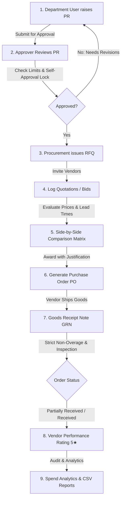

# 🌟 e-Procurement — Enterprise Procurement & Vendor Management System

A high-performance, full-stack **MERN** enterprise procurement platform built strictly to the specifications of `MERN_Procurement_Vendor_Management_Intern_Task.docx`. Featuring strict business validation rules, role-based access control (RBAC), end-to-end procurement lifecycle tracking, and a bespoke **"Plum & Peach"** luxury enterprise design language.

---

## 🎨 Unique Theme: "Plum & Peach" Luxury Design System

e-Procurement features an intentional, bespoke color hierarchy engineered for high-density enterprise workflows:

| Token | Hex Code | Purpose |
| :--- | :--- | :--- |
| **Deep Velvet Plum** | `#2C0E36` / `#461756` | Primary brand headers, sidebars, executive badges |
| **Electric Royal Plum** | `#571C6B` | Primary interactive states, active tabs, buttons |
| **Warm Peach / Coral** | `#FF7E5F` / `#FFA088` | Key action highlights, award tags, star ratings |
| **Soft Peach Glow** | `#FFEFEA` | Alert highlights, notification count badges |
| **Plum Mist Background**| `#FAF2FC` | Surface accents, light table row zebra striping |
| **Typography** | `Plus Jakarta Sans` | Modern geometric sans-serif for crystal-clear readability |

---

## 🚀 Key Modules & End-to-End Procurement Flow



### 1. Purchase Requisitions (PR)
- Multi-item line builder with live quantity, unit price, and subtotal calculation.
- Save as **Draft** or submit for managerial review.
- Dynamic urgency markers (`Low`, `Medium`, `High`, `Critical`).
- Sequential audit trail timeline logging every approval, edit, or rejection.

### 2. Request for Quotations (RFQ) & Bid Comparison
- One-click RFQ generation directly from approved purchase requisitions.
- Vendor invitation filtering by product/service categories.
- Strict closing date validation — bids cannot be logged after RFQ expiration.
- **Side-by-Side Quotation Comparison Matrix**: Highlights the **Lowest Price** and **Fastest Lead Time** automatically.
- Audited Vendor Awarding with **mandatory justification remarks**.

### 3. Purchase Orders (PO) & Version Snapshotting
- Automatic PO creation with computed subtotal, 10% tax calculation, and net total.
- **Immutable Revision History**: Modifying an issued PO locks previous terms into an audit snapshot and increments the revision counter (`Rev 1`, `Rev 2`, etc.) with mandatory change reasons.
- **Printable Executive Invoice Modal**: Ready for physical signing and vendor dispatch.

### 4. Goods Receipt Notes (GRN) & 3-Way Matching
- Line-by-line item intake matrix showing: *Ordered*, *Previously Received*, *Current Intake*, *Damaged*, and *Remaining*.
- **Strict Overage Prevention**: The backend and frontend strictly reject intake if `(received + current) > ordered`.
- Supporting document uploads (Delivery notes, inspection test sheets).
- Automatic PO status progression: `Issued` ➔ `Partially Received` ➔ `Received`.

### 5. Vendor Performance Ratings
- **Gated Evaluation**: Ratings are strictly unlocked **only post-delivery** against orders with received goods.
- 3-metric 5-star scoring:
  1. *Timeliness / Delivery Speed*
  2. *Product / Service Quality*
  3. *Vendor Communication & Support*
- Running average computation updated automatically across all vendor scorecards.

### 6. Spend Analytics & Exportable Reports
- Date range picker with one-click presets (*All Time*, *Last 30 Days*, *This Month*, *This Year*).
- Multi-dimensional filters (Department, Vendor, PO Status).
- Live KPI aggregate metrics: Filtered Spend, Order Count, Average Order Value, Fulfillment Rate.
- **1-Click Export to CSV** downloading formatted audit records directly to disk.

### 7. User & Department Administration (Admin Only)
- User directory with search, role filters, and department assignments.
- Financial approval limit threshold controls.
- Account activation/deactivation toggle (with self-deactivation safeguards).
- Direct password reset modal.
- Department/Cost Center creation and code management (`IT`, `OPS`, `FIN`, `HR`).

---

## 🔒 Enterprise Business Rules & Security

1. **Separation of Duties**: Users cannot approve their own Purchase Requests, even if they hold managerial or administrative privileges.
2. **Approval Limit Enforcement**: Approvers cannot approve PR amounts exceeding their configured financial threshold.
3. **Mandatory Justification**: Rejection or returning of PRs, as well as awarding RFQs and revising POs, require detailed justification logs.
4. **Data Isolation**: Department users only see requisitions belonging to their assigned department, while Procurement Managers and Admins possess organization-wide visibility.
5. **No Silent PO Edits**: Changes to financial terms or shipping terms on issued POs require a reason and are permanently preserved in historical revision snapshots.

---

## 👥 Pre-Configured Demo Accounts

For instant evaluation, the Login page includes **1-Click Quick Login Pills** that pre-fill credentials for all roles:

| Role | Email | Password | Department | Approval Limit |
| :--- | :--- | :--- | :--- | :--- |
| **System Admin** | `admin@local.com` | `password123` | Headquarters | Unrestricted ($1,000,000) |
| **Procurement Manager** | `procurement@local.com` | `password123` | Procurement Dept | $50,000 |
| **IT Requester** | `user.it@local.com` | `password123` | IT & Systems | $5,000 |
| **Operations Requester**| `user.ops@local.com` | `password123` | Operations | $5,000 |

---

## 🛠️ Installation & Setup

### 1. Prerequisites
- **Node.js**: v18 or higher (tested on Node v20/v24)
- **MongoDB**: Local MongoDB instance (`mongodb://127.0.0.1:27017/procurement_system`) or MongoDB Atlas.

### 2. Environment Configuration
The backend configuration is stored in `backend/.env`:
```env
PORT=5000
MONGO_URI=mongodb://127.0.0.1:27017/procurement_system
JWT_SECRET=super_secret_procurement_jwt_key_2026_plum_peach_production
JWT_EXPIRES_IN=7d
```

### 3. Seed Database
From the `backend` folder, execute the enterprise seed script:
```bash
cd backend
npm run seed
```
*This populates test departments, users, 5 vendors with product catalogs, historical PRs, awarded RFQs, POs, GRN logs, vendor ratings, and unread notifications.*

### 4. Start the Application
Open two terminal windows:

**Terminal 1 (Backend API):**
```bash
cd backend
npm run dev
# Running on http://localhost:5000
```

**Terminal 2 (Frontend Client):**
```bash
cd frontend
npm run dev
# Running on http://localhost:3000
```

---

## 📬 Postman API Collection

A fully tested, production-grade Postman collection is included in the project root:
- File: [`postman_collection.json`](file:///d:/WORKING/SMUFTECH/procurement-system/postman_collection.json)
- Includes 11 comprehensive folders covering **all 30+ endpoints**.
- Configured with automatic collection token extraction upon running any Login request.

---

## 📁 Repository Structure

```
procurement-system/
├── backend/
│   ├── config/             # Database connection setup
│   ├── controllers/        # Business logic controllers
│   ├── middleware/         # Auth, RBAC, Multer upload
│   ├── models/             # Mongoose schemas (User, Dept, PR, RFQ, PO, GRN, Vendor, etc.)
│   ├── routes/             # RESTful API route definitions
│   ├── uploads/            # Multer document upload directory
│   ├── utils/              # Real-time in-app notification engine
│   ├── seed.js             # Comprehensive enterprise demo database seeder
│   └── server.js           # Express app bootstrap
├── frontend/
│   ├── public/             # Static public assets
│   ├── src/
│   │   ├── api/            # Axios instance with auth interceptor
│   │   ├── components/     # Navbar, ProtectedRoute, Notifications, Modals
│   │   ├── context/        # AuthContext with token refresh and RBAC flags
│   │   ├── pages/          # All 9 VIP Plum & Peach application views
│   │   ├── App.jsx         # App router configuration
│   │   └── index.css       # Plum & Peach Design System tokens and styles
│   └── package.json
├── postman_collection.json # Complete API collection
└── README.md
```
