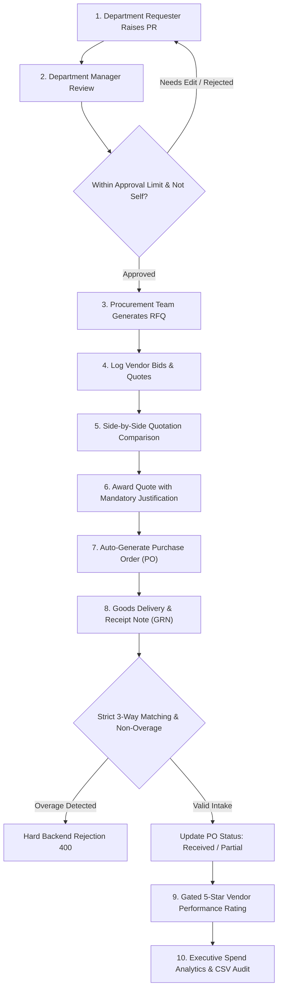

<div align="center">

# 🌟 e-Procurement Suite
### Enterprise Procurement & Vendor Management Orchestration Platform

*A high-assurance, full-stack enterprise procurement ecosystem built with the MERN stack, featuring mathematical 3D telemetry, strict 3-way matching, gated vendor performance ratings, and an intentional luxury **"Plum & Peach"** design system.*

<br/>

[](https://react.dev/)
[](https://nodejs.org/)
[](https://expressjs.com/)
[](https://www.mongodb.com/)
[](https://vitejs.dev/)
[](https://jwt.io/)
[](LICENSE)
[](https://github.com/Jasir-ali90)

<br/>

[Key Highlights](#-key-modules--procurement-lifecycle) •
[Plum & Peach UI](#-bespoke-design-system-plum--peach) •
[Demo Accounts](#-pre-configured-demo-accounts) •
[Quickstart](#-quickstart--installation) •
[API Reference](#-restful-api-endpoints) •
[Postman Collection](#-postman-api-collection)

---

</div>

<br/>

## 🎯 Executive Overview

**e-Procurement Suite** solves the systemic operational bottlenecks in multi-department enterprise purchasing: rogue spending, supplier opacity, invoice discrepancies, and manual approval delays. 

Built strictly to real-world corporate governance standards, the platform enforces:
* 🔒 **Separation of Duties (SoD)**: Users are cryptographically barred from self-approving their own purchase requisitions.
* 🛡️ **Tiered Financial Authority**: Multi-level managerial approval thresholds with cost-center budget enforcement.
* ⚖️ **Audited RFQ Bidding**: Objective side-by-side supplier quotation comparisons highlighting lowest price and fastest turnaround.
* 📦 **3-Way Matching Intake (GRN)**: Hard inventory overage prevention against original Purchase Orders.
* ⭐ **Post-Delivery Vendor Ratings**: Multi-dimensional scorecard ratings gated until physical goods are received.
* 🌌 **Interactive 3D Canvas Atmosphere**: High-assurance login portal featuring 3D gemstone polyhedrons, orbital photon comets, and real-time telemetry HUD sparklines.

---

## 🎨 Bespoke Design System: "Plum & Peach"

The application rejects generic corporate dashboard templates in favor of a curated, high-density **"Plum & Peach"** aesthetic:

| Color Palette Token | Hex Code | Visual Identity & Enterprise Purpose |
| :--- | :---: | :--- |
| **Deep Velvet Plum** | ` #2C0E36 ` | 🟣 Primary brand headers, navigation sidebars, high-assurance badges |
| **Electric Royal Plum** | ` #571C6B ` | 🔮 Primary interactive triggers, active navigation items, focal buttons |
| **Warm Peach / Coral** | ` #FF7E5F ` | 🍑 Primary call-to-actions, award tags, highest-priority badges |
| **Soft Peach Glow** | ` #FFEFEA ` | 🌸 Notification counters, highlight banners, hover background accents |
| **Subtle Plum Mist** | ` #FAF2FC ` | 🪞 Clean table zebra-striping, subtle cards, secondary container fills |
| **Emerald Assurance** | ` #34D399 ` | 🟢 Approved statuses, GRN completions, positive financial trends |
| **Amber Caution** | ` #FBBF24 ` | 🟡 Pending reviews, quotation evaluation markers, 5★ rating stars |

> **Typography**: Powered by `Plus Jakarta Sans` across all interfaces, providing optimal optical weight balancing between numeric financial data and dense procurement tables.

---

## 🚀 Key Modules & Procurement Lifecycle



<br/>

### 1. 📝 Purchase Requisitions (PR) Engine
* **Dynamic Item Matrix**: Multi-item line builder calculating live quantity, unit price, and subtotal lines.
* **State Lifecycle**: Transitions across `Draft` ➔ `Submitted` ➔ `Approved` ➔ `Returned For Correction` ➔ `Rejected`.
* **Chronological Audit Trail**: Every status change permanently timestamps the approver, previous state, and justification notes.
* **Cost Center Segregation**: Requesters are restricted to their assigned department's ledger.

### 2. 📑 Request for Quotations (RFQ) & Bid Matrix
* **1-Click Generation**: Transform approved PR items directly into RFQ bid collections.
* **Category Filtering**: Invite certified vendors categorized by matching commodity codes (`Hardware`, `Networking`, `Facilities`).
* **Expiration Gates**: Quotations cannot be submitted after the configured RFQ closing timestamp.
* **Side-by-Side Matrix**: Visual comparison table that automatically isolates:
  * 🏷️ **Lowest Unit Price**
  * ⏱️ **Fastest Lead Time**
* **Audited Awarding**: Generating a PO requires mandatory executive award remarks explaining vendor selection.

### 3. 📜 Purchase Orders (PO) & Version Snapshotting
* **Automated Computation**: PO subtotal, automatic 10% VAT/tax calculations, and net totals.
* **Immutable Snapshotting**: Modifying terms on an issued PO creates a locked snapshot (`Rev 1`, `Rev 2`) preserving historical terms and requiring mandatory change justification.
* **Printable Executive Invoicing**: Clean invoice view ready for physical signing, stamping, and external supplier dispatch.

### 4. 📦 Goods Receipt Notes (GRN) & 3-Way Matching
* **Multi-Item Receiving Matrix**: Visual tracking of `Ordered`, `Previously Received`, `Current Intake`, `Damaged`, and `Remaining Balance`.
* **Zero-Overage Enforcement**: The backend strictly aborts intake if `(previously_received + current_intake) > ordered_quantity`.
* **Document Attachment**: Upload supplier delivery notes and inspection test reports via Multer.
* **Automated Status Progression**: Dynamically cascades PO status from `Issued` ➔ `Partially Received` ➔ `Received`.

### 5. ⭐ Gated Vendor Performance Ratings
* **Delivery-Gated Security**: Ratings are locked until items are physically accepted via a verified GRN.
* **3-Metric Scoring**:
  1. 🚚 *Timeliness & Delivery Adherence (1-5★)*
  2. 💎 *Item Quality & Specification Compliance (1-5★)*
  3. 💬 *Communication & Support Professionalism (1-5★)*
* **Real-Time Scorecard**: Running averages instantly recalculate across the global Vendor Directory.

### 6. 📊 Executive Spend Analytics & Audit Reporting
* **Interactive Date Filtering**: One-click temporal presets (*All Time*, *Last 30 Days*, *This Month*, *This Year*).
* **Cross-Dimensional Slicing**: Instant filtering by Department, Vendor, and Fulfillment Status.
* **Core KPI Widgets**: Total Committed Spend, Average Order Value (AOV), Order Count, and On-Time Delivery Rate.
* **1-Click Audit Export**: Exports full procurement transaction logs directly to sanitized CSV format.

### 7. 🔔 Real-Time Notification Engine
* **Instant Event Triggers**: Requisition approvals, return notifications, quotation awards, and delivery intakes.
* **Unread Counter**: Badge counts update dynamically in the top navigation bar.
* **One-Click Read Management**: Mark individual or batch clear alerts with a single click.

---

## 👥 Pre-Configured Demo Accounts

For instant evaluation, the login portal includes **1-Click Quick Demo Role Pills** that pre-fill test credentials:

| Role Badge | Email Address | Password | Assigned Department | Financial Limit | System Authority |
| :--- | :--- | :---: | :--- | :---: | :--- |
| **System Admin** | `admin@local.com` | `password123` | Headquarters | **$1,000,000** | Full system governance, user directory, cost centers |
| **Procurement Officer** | `procurement@local.com` | `password123` | Procurement Dept | **$50,000** | RFQ creation, bid comparisons, PO generation |
| **IT Requester** | `user.it@local.com` | `password123` | Information Technology | **$5,000** | PR creation, line item drafting, IT requisitions |
| **Operations Requester** | `user.ops@local.com` | `password123` | Operations & Facilities | **$5,000** | Operations requisitions, delivery tracking |

---

## 🛠️ Quickstart & Installation

### 1. Prerequisites
* **Node.js**: `v18.x` or higher (tested on `v20` and `v24`)
* **Package Manager**: `npm` (v9+)
* **Database**: MongoDB (Local instance at `mongodb://127.0.0.1:27017` or MongoDB Atlas cluster)

### 2. Clone Repository
```bash
git clone https://github.com/Jasir-ali90/procurement-system.git
cd procurement-system
```

### 3. Environment Configuration
Create an environment file in `backend/.env` using the provided template:

```bash
# Copy template
cp backend/.env.example backend/.env
```

Ensure the variables match your environment:
```env
PORT=5000
MONGO_URI=mongodb://127.0.0.1:27017/procurement_system
JWT_SECRET=super_secret_procurement_jwt_key_2026_plum_peach_production
JWT_EXPIRES_IN=7d
```

### 4. Install Dependencies
Install packages for both the backend and frontend:

```bash
# Root & Backend dependencies
npm install
cd backend && npm install

# Frontend dependencies
cd ../frontend && npm install
cd ..
```

### 5. Seed Demonstration Database
Populate test departments, users, 5 certified vendors with preloaded item catalogs, historical PRs, awarded RFQs, PO revisions, GRN receipts, and ratings:

```bash
cd backend
npm run seed
cd ..
```

### 6. Run the Application
Launch both servers concurrently:

```bash
# Terminal 1: Backend API (Port 5000)
cd backend
npm run dev

# Terminal 2: Frontend Vite Client (Port 3000)
cd frontend
npm run dev
```

Visit **`http://localhost:3000`** in your browser.

---

## 📡 RESTful API Endpoints

The backend provides over 30 authenticated REST endpoints documented below:

<details>
<summary><b>🔐 Authentication & Profile (`/api/auth`)</b></summary>

| Method | Endpoint | Description | Access Level |
| :---: | :--- | :--- | :--- |
| `POST` | `/api/auth/login` | Authenticate user & return JWT token | Public |
| `GET` | `/api/auth/me` | Fetch authenticated session profile | Authenticated |
| `PUT` | `/api/auth/change-password` | Update account password | Authenticated |
</details>

<details>
<summary><b>📝 Purchase Requisitions (`/api/prs`)</b></summary>

| Method | Endpoint | Description | Access Level |
| :---: | :--- | :--- | :--- |
| `GET` | `/api/prs` | List requisitions (filtered by RBAC) | Authenticated |
| `POST` | `/api/prs` | Create a new draft purchase requisition | Authenticated |
| `GET` | `/api/prs/:id` | Fetch detailed PR with audit history | Authenticated |
| `PUT` | `/api/prs/:id` | Update line items (Draft / Returned only) | Requester |
| `PUT` | `/api/prs/:id/submit` | Submit PR for managerial review | Requester |
| `PUT` | `/api/prs/:id/approve` | Approve PR (Enforces SoD & limit checks) | Approvers |
| `PUT` | `/api/prs/:id/reject` | Reject PR with required justification | Approvers |
| `PUT` | `/api/prs/:id/return` | Return PR to requester for corrections | Approvers |
</details>

<details>
<summary><b>📑 Request for Quotations (`/api/rfqs`)</b></summary>

| Method | Endpoint | Description | Access Level |
| :---: | :--- | :--- | :--- |
| `GET` | `/api/rfqs` | List all RFQs with status filtering | Authenticated |
| `POST` | `/api/rfqs` | Create an RFQ from an approved PR | Procurement / Admin |
| `GET` | `/api/rfqs/:id` | Fetch RFQ with invited vendor details | Authenticated |
| `POST` | `/api/rfqs/:id/bids` | Log quotation submitted by invited vendor | Procurement / Admin |
| `PUT` | `/api/rfqs/:id/award` | Award RFQ to winning bid with reason | Procurement / Admin |
</details>

<details>
<summary><b>📜 Purchase Orders (`/api/pos`)</b></summary>

| Method | Endpoint | Description | Access Level |
| :---: | :--- | :--- | :--- |
| `GET` | `/api/pos` | List all issued purchase orders | Authenticated |
| `GET` | `/api/pos/:id` | Fetch PO with line items & revision history | Authenticated |
| `PUT` | `/api/pos/:id/revise` | Revise PO terms and snapshot previous version | Procurement / Admin |
</details>

<details>
<summary><b>📦 Goods Receipt Notes (`/api/grns`)</b></summary>

| Method | Endpoint | Description | Access Level |
| :---: | :--- | :--- | :--- |
| `GET` | `/api/grns` | List all GRN records | Authenticated |
| `POST` | `/api/grns` | Create GRN with non-overage validation | Warehouse / Procurement |
| `GET` | `/api/grns/po/:poId` | Fetch intake records for a specific PO | Authenticated |
</details>

<details>
<summary><b>🏢 Vendors & Ratings (`/api/vendors`)</b></summary>

| Method | Endpoint | Description | Access Level |
| :---: | :--- | :--- | :--- |
| `GET` | `/api/vendors` | List active vendors with running ratings | Authenticated |
| `POST` | `/api/vendors` | Register a new enterprise vendor | Procurement / Admin |
| `GET` | `/api/vendors/:id` | Fetch vendor scorecard & catalog | Authenticated |
| `POST` | `/api/vendors/:id/rate` | Submit gated 5-star performance rating | Authenticated |
</details>

<details>
<summary><b>📈 Spend Analytics & Reports (`/api/analytics`)</b></summary>

| Method | Endpoint | Description | Access Level |
| :---: | :--- | :--- | :--- |
| `GET` | `/api/analytics/summary` | Global procurement KPI summaries | Authenticated |
| `GET` | `/api/analytics/spend` | Filtered spend breakdowns & department totals | Authenticated |
| `GET` | `/api/analytics/export` | Stream sanitized CSV audit report | Authenticated |
</details>

<details>
<summary><b>🔔 Notifications & Administration (`/api/notifications`, `/api/users`, `/api/departments`)</b></summary>

| Method | Endpoint | Description | Access Level |
| :---: | :--- | :--- | :--- |
| `GET` | `/api/notifications` | Fetch unread and recent user notifications | Authenticated |
| `PUT` | `/api/notifications/:id/read` | Mark individual notification as read | Authenticated |
| `PUT` | `/api/notifications/read-all` | Batch mark all notifications as read | Authenticated |
| `GET` | `/api/users` | List corporate directory | Admin Only |
| `POST` | `/api/users` | Provision new enterprise user | Admin Only |
| `GET` | `/api/departments` | List all registered cost centers | Authenticated |
| `POST` | `/api/departments` | Register new department code | Admin Only |
</details>

---

## 📬 Postman API Collection

A complete, production-tested Postman collection is included directly in the root directory:
* **File**: [`postman_collection.json`](file:///d:/WORKING/SMUFTECH/procurement-system/postman_collection.json)
* **Highlights**:
  * Organized into **11 categorized folders** mirroring enterprise workflows.
  * Contains automated **test scripts** that automatically save the Bearer token to collection variables upon logging in.
  * Pre-configured with dynamic URL variables for both `http://localhost:5000` and remote servers.

---

## 📁 Repository Directory Structure

```
procurement-system/
├── 📂 backend/
│   ├── 📂 config/             # MongoDB database connection configuration
│   ├── 📂 controllers/        # Express request handlers (Auth, PR, RFQ, PO, GRN, Vendors, Analytics)
│   ├── 📂 middleware/         # JWT verification, RBAC permissions, Multer file handling
│   ├── 📂 models/             # Mongoose schemas (User, Department, PR, RFQ, PO, GRN, Vendor, Rating)
│   ├── 📂 routes/             # RESTful route definitions mapping to controllers
│   ├── 📂 uploads/            # Secure storage for GRN inspection test sheets & delivery slips
│   ├── 📂 utils/              # In-app real-time notification engine
│   ├── 📄 seed.js             # Comprehensive enterprise seeder populating rich demo data
│   ├── 📄 server.js           # Main Express server bootstrap
│   └── 📄 .env.example        # Environment variable specification template
├── 📂 frontend/
│   ├── 📂 public/             # Static SVGs, favicon, and logos
│   ├── 📂 src/
│   │   ├── 📂 api/            # Axios instance with automatic JWT Bearer token injection
│   │   ├── 📂 components/     # High-assurance 3D Canvas, Navbar, Sidebar, Modals, Loaders
│   │   ├── 📂 context/        # AuthContext managing session persistence and RBAC state
│   │   ├── 📂 pages/          # 9 Enterprise Views (Dashboard, PR, RFQ, PO, GRN, Vendors, Ratings, Reports, Admin)
│   │   ├── 📄 App.jsx         # Client routing with role-protected route guards
│   │   ├── 📄 index.css       # Plum & Peach Design System tokens, animations, and typography
│   │   └── 📄 main.jsx        # React DOM application mount
│   ├── 📄 vite.config.js      # Vite build configuration with proxy setup
│   └── 📄 package.json        # Frontend dependencies
├── 📄 postman_collection.json # Complete 30+ endpoint Postman API collection
├── 📄 .gitignore              # Strict ignore rules protecting environment files and credentials
└── 📄 README.md               # Architecture documentation & system manual
```

---

## 🔒 Enterprise Security & Compliance

1. **Self-Approval Lockout**: A hard validation block checks `requester_id !== approver_id` at the database level, preventing fraud even if an Admin attempts to approve their own PR.
2. **Approval Limit Enforcement**: Requisitions exceeding an approver's designated ceiling cannot be approved without escalation.
3. **Audit Trail Immutability**: Critical actions (PR returns, RFQ awards, PO revisions) require mandatory rationale remarks and append to append-only history arrays.
4. **Input Sanitization & Data Safety**: Strict Mongoose schema casting and validation rules prevent unauthorized fields and overage intakes.

---

## 👨‍💻 Developed By

<div align="center">

### **Jasir Ali**
*Full-Stack Software Engineer & Solutions Architect*

[](https://github.com/Jasir-ali90)
[](https://www.linkedin.com/)
[](https://github.com/Jasir-ali90/procurement-system)

<br/>

**Built with precision and high-assurance engineering for enterprise procurement excellence.**

*© 2026 Jasir Ali. All rights reserved.*

</div>
